# 泡泡猫的影视工具 v1.0.0 · 重构发布说明

> 这一版不是加功能，是**把 15 个页面重做成同一套产品**：统一两列骨架（左展示 / 右参数）、
> 统一表单与按钮、统一深色皮肤，并把此前"看起来能用、其实是空壳"的功能逐个换成真实实现。
> 每一项都附真实截图或成片，产物均由本机实际运行产生。

---

## 一、兼容性（重要）

| 项目 | 要求 | 说明 |
|---|---|---|
| **DSH 版本** | **0.2.2-rc.3 实测通过** | 本版所有截图与验证都在该版本上完成 |
| DSH 版本范围 | `@deepseek-ai/dsh-host-webserver` / `dsh-client-runtime`：`^0.1.0-rc.6 \|\| ^0.2.0-rc.1` | 超出该范围请先在测试环境验证 |
| Cordis | `@deepseek-ai/cordis` **^4.0.1** | 客户端与宿主两端都依赖 |
| DSH 客户端注入 | runtime / store / ui-conversation / ui-layout / ui-tool | 五项必须齐全，缺一项面板不会加载 |
| 运行平台 | **web**（`dsh.client.platform = web`） | 桌面版与 `dsh web` 均可 |
| ffmpeg / ffprobe | 任意 4.x+ | 拼接、字幕、混音、抽帧；可用 `AGNES_FFMPEG` 指定路径 |
| 中文字体 | 任一 CJK 字体 | 烧录中文字幕；可用 `AGNES_SUBTITLE_FONT` 指定 |
| Node | 跟随 DSH 自带运行时 | 插件不额外要求 Node 版本 |

> 宿主半改动**需要重启 DSH** 才生效；客户端半刷新页面即可。

---

## 二、这次重构改了什么

### 1. 布局：15 个页面统一成「左展示 / 右参数」

以前 16 个页面 16 套排布，换一个页签就要重新找按钮。现在统一为：

- **左列**：看的东西（结果、列表、预览、分镜、成片）
- **右列**：填的东西（表单、按钮、进度）
- 右列固定 320px，可一键收起；窄屏（<1080px）自动叠成上下两段

| 模块 | 截图 |
|---|---|
| 生图 | 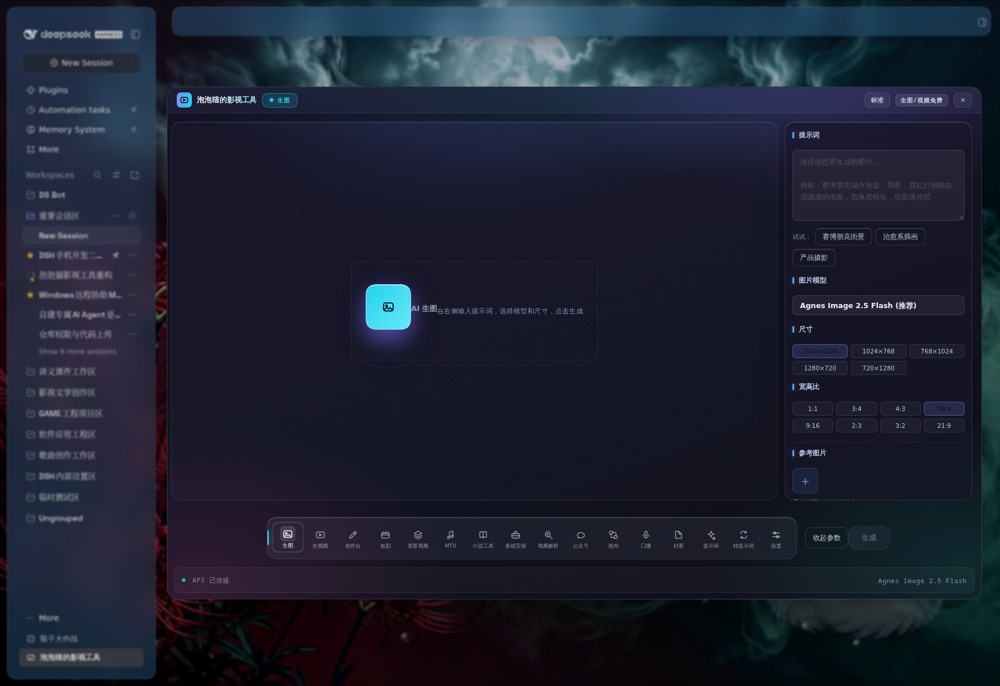 |
| 多能宝箱（素材库） | 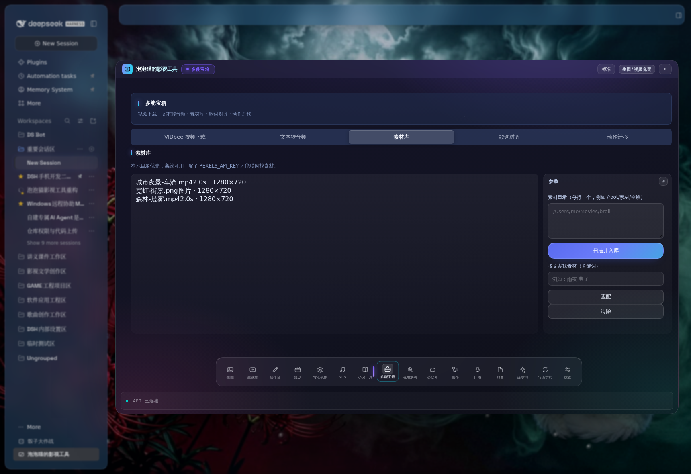 |
| 小说工具 |  |
| 公众号 | 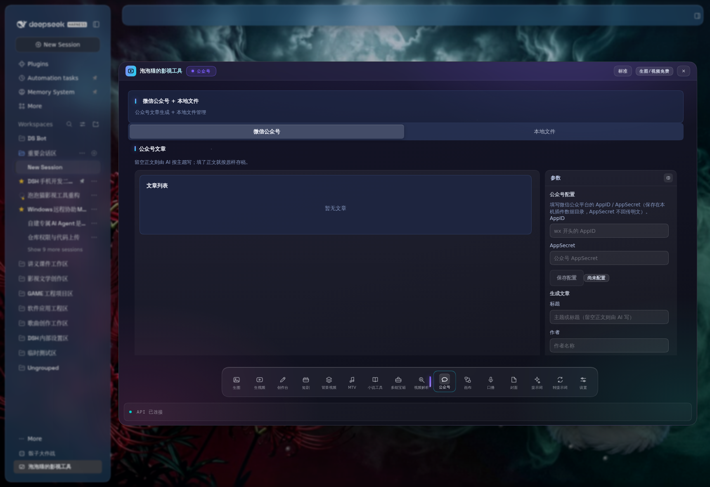 |
| 视频解析 | 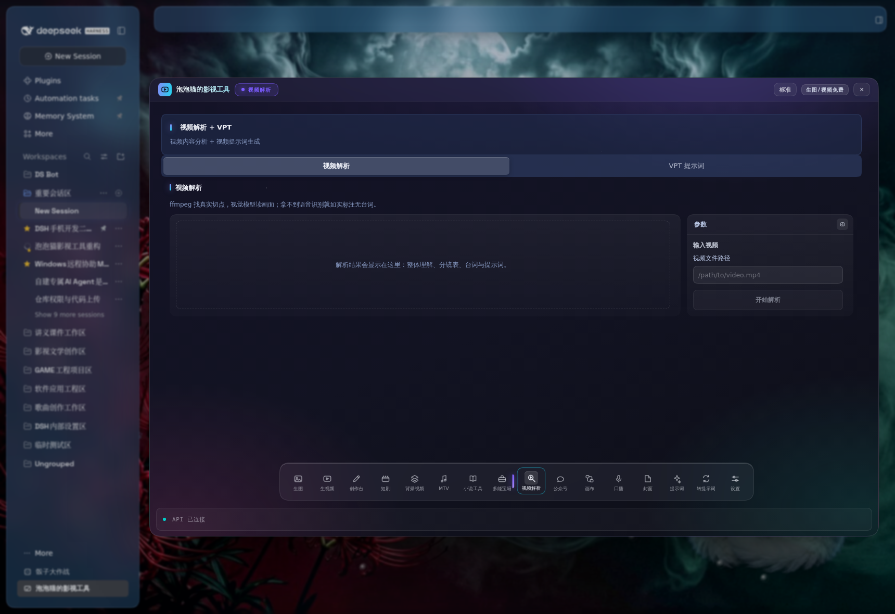 |
| 背景视频 |  |
| MTV | 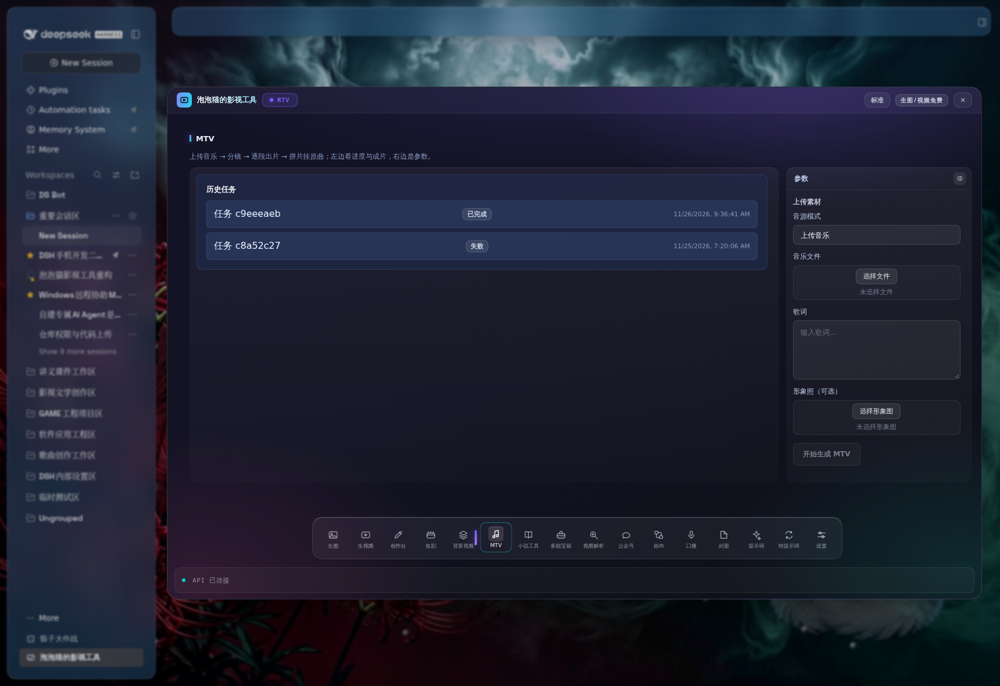 |
| 封面 | 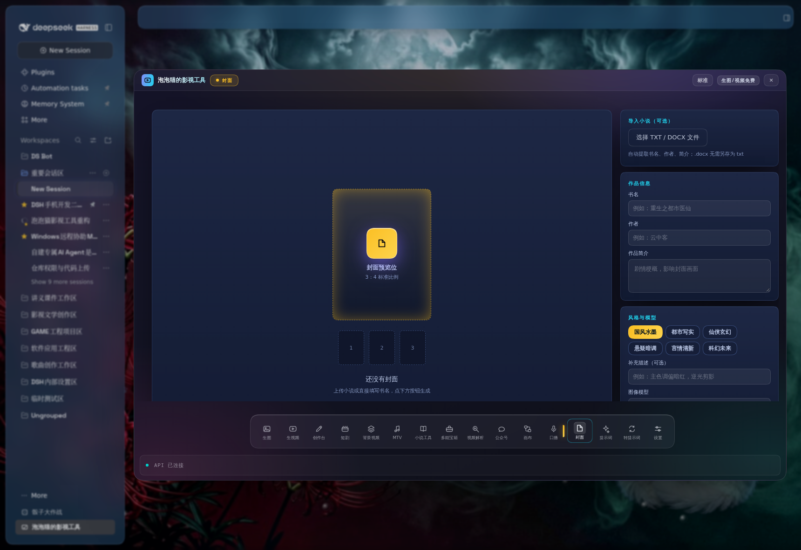 |
| 提示词专家 | 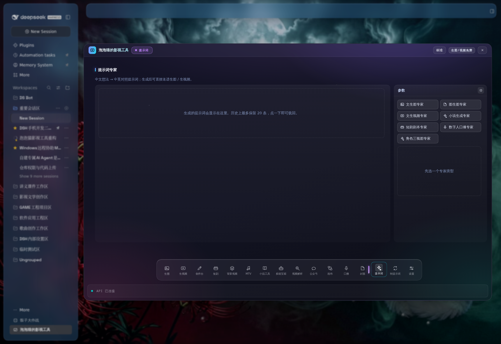 |
| 设置 | 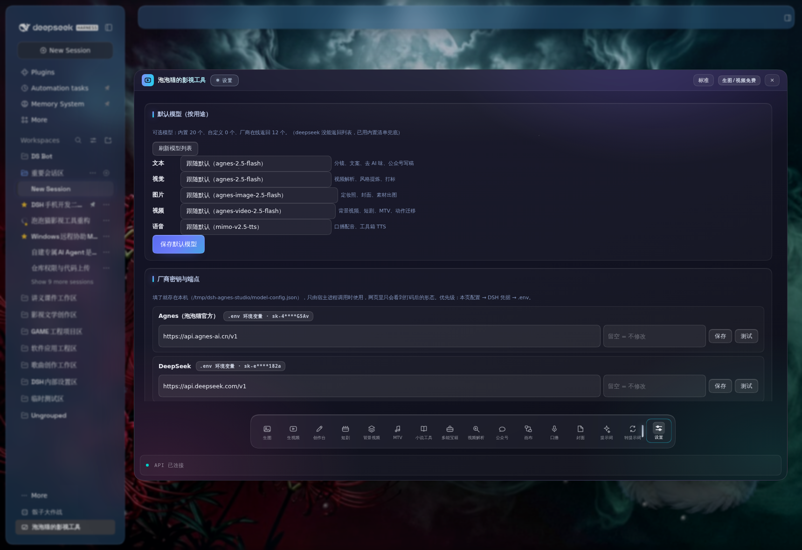 |
| 短剧 | 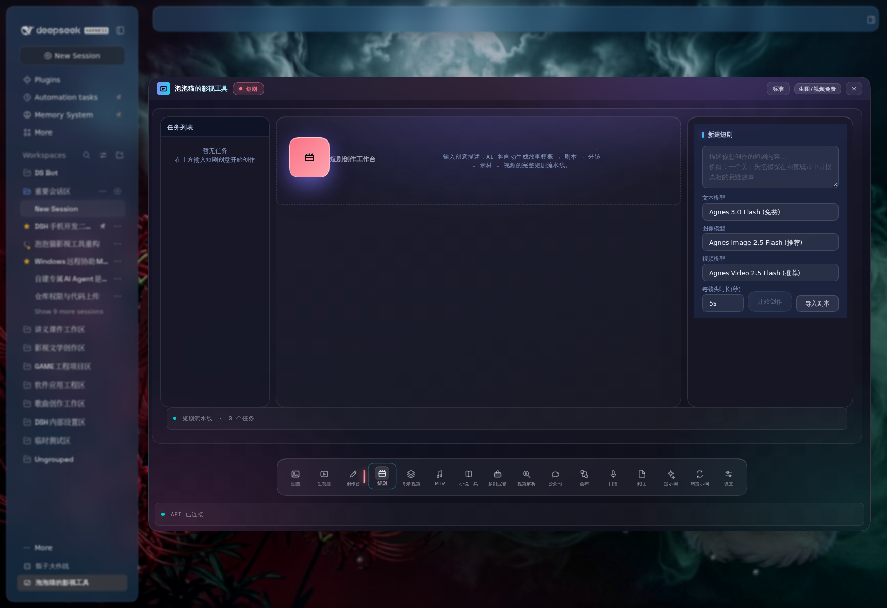 |
| 口播 | 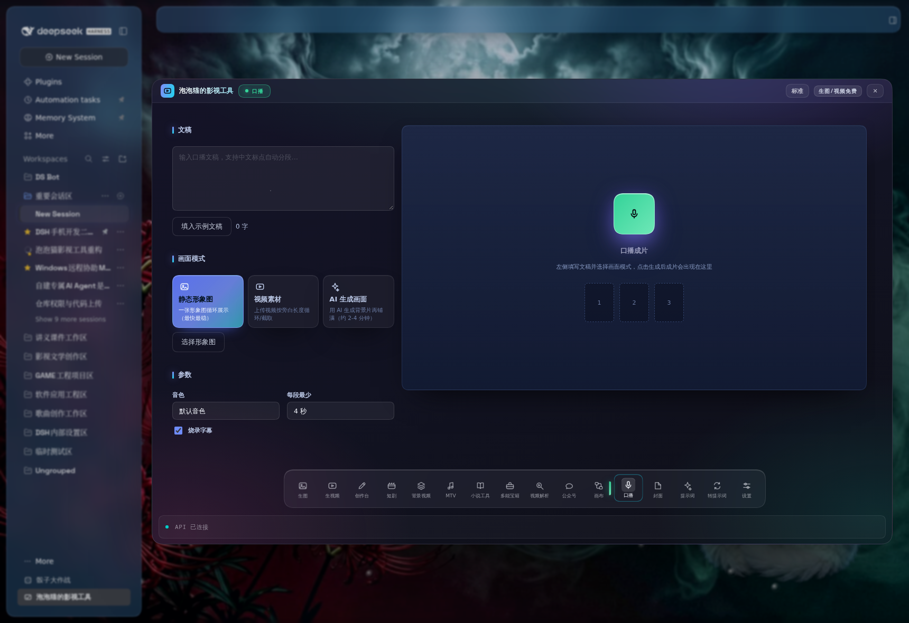 |
| 小说创作台 | 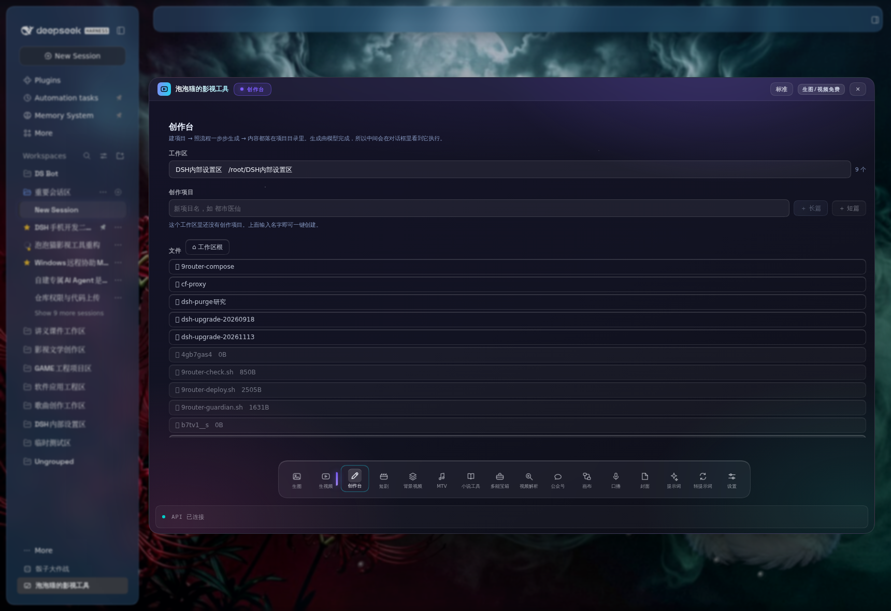 |
| 创作台（画布） |  |

> 创作台是拖拽画布，保留自有布局（塞进两列反而别扭）。

### 2. 表单控件：从"白补丁"到统一的深色玻璃

以前深色面板里嵌着一堆纯白输入框，文件选择器还是英文的 `Choose File / No file chosen`。

根因有两个，都不在设计上：

- `08-light.ts` 里一条 `input{background:#fff !important}` **没有主题判断**，深色主题照样生效；
- 原生 `<input type="file">` 的按钮文案跟系统语言走，CSS 改不了。

现在的做法：深色规则只在插件作用域内生效；文件选择换成自研 `FileField` 组件，文案固定中文。

| 前 | 后 |
|---|---|
| 白底输入框 + 英文 Choose File | 深色玻璃 + 「选择文件 / 未选择文件」 |

### 3. 主题：取消浅色，只保留深色一套皮肤

理由很直接：两套皮肤要维护的覆盖规则翻倍，而浅色那套带着 `!important` 的白底规则，
正是上面"白补丁"的根源。标题栏的「亮色」开关已移除，面板恒为深色。
即使 DSH 本体是浅色主题，插件依然是深色。

### 4. 按钮与徽标：一个页面只有一个主按钮

`secondary` 按钮此前被写成纯白底（`#fff !important`），深色下就是一排"白胶囊"。
现在：次要按钮是浅色叠加、主按钮才是强调色渐变，行内的保存/测试降为次要。

### 5. 模型：从"写死"到「按用途」解析

以前只有生图/生视频能选模型，分镜、写稿、解析、配音都在代码里写死了模型名 ——
你填了多个模型，功能仍然只认那一个。

现在按**用途**分五类，各一个默认：

| 用途 | 覆盖的功能 | 默认 |
|---|---|---|
| 文本 | 分镜、文案、去 AI 味、公众号、小说拆分 | agnes-2.5-flash |
| 视觉 | 视频解析、风格提炼、打标 | agnes-2.5-flash |
| 图片 | 定妆照、封面、素材出图 | agnes-image-2.5-flash |
| 视频 | 背景视频、短剧、MTV、动作迁移 | agnes-video-2.5-flash |
| 语音 | 口播配音、工具箱 TTS | mimo-v2.5-tts |

解析顺序：**面板显式选择 → 设置里的用途默认 → 环境变量 → 内置兜底**。

下拉里的可选模型来自三层合并：**内置清单 + 你的自定义模型 + 厂商 `/models` 在线返回**。

### 6. 素材库（新）

本地目录优先，离线可用：ffprobe 体检（时长/分辨率/有无音轨）+ 文件名与目录词元打标
（中文补 2-gram，所以"城市夜景"能被"夜景"命中）。Pexels 仅作补充，且只给候选不自动入库。

### 7. 歌词对齐（新）

按字数比例分配 + `silencedetect` 停顿吸附。每行都标注是「吸附」还是「比例」，
不假装逐字精确。实测 8.48s 语音、4 处停顿全部吸附成功。

### 8. 动作迁移（新）

走 `/v1/videos` 的 reference 模式，模型名可用 `DSH_ANIMATE_MODEL` 指定。
平台没上架对应模型时会如实报出平台原文，不假装成功。

### 9. ComfyUI 接入（新）

`system_stats / object_info / prompt / history / view` 全套 + 默认最小 workflow（SD 文生图）。
未配置时状态显示"连接失败：还没有配置 ComfyUI 地址"。

### 10. KEY 池（新）

多 KEY 轮换 + 冷却：401/403 → 30 分钟、429 → 60 秒、5xx → 20 秒 × 次数。
用 `<厂商>_API_KEY_2`、`_3` 这样的环境变量即可进池。

### 11. 空壳功能全部换成真实现

| 模块 | 以前 | 现在 |
|---|---|---|
| 背景视频 | 16 处写死字符串（"第 N 幕画面描述"） | 分幕/分镜/定妆/定锚/抽帧/风格/出片全部真实调用 |
| MTV | 304 行纯空壳，每阶段 sleep 2 秒编个 id | 分镜 → 逐段出片 → 拼接 → 混原曲 |
| 公众号 | 存稿 + 改状态字段 | 真调文本模型写稿；发布真调微信草稿 API |
| 小说工具 | 导入返回"模拟小说内容…" | 真读文件、真切章、写 EP 文件、去 AI 味分块改写 |
| 多能宝箱 | TTS 塞一个不存在的 demo.mp3 | 真实 MiMo TTS，返回 WAV |
| 视频反推 | 5 条假场景 | ffmpeg 真切点 + 两阶段视觉模型 + 报告导出 |

---

## 三、真实产物（不是示意图）

| 类型 | 文件 | 规格 |
|---|---|---|
| 生图 | 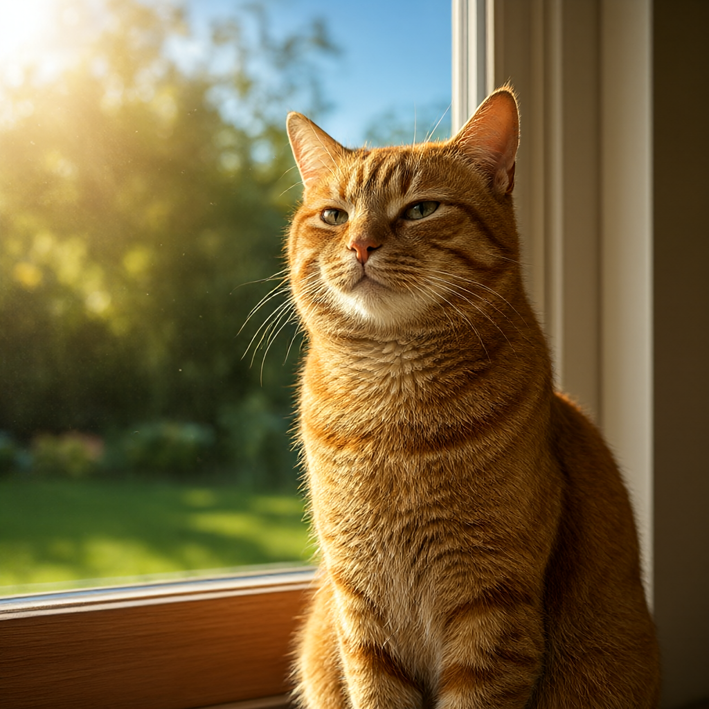 | 1024×1024 · 1.63MB |
| 生视频 | [21-产物-生视频.mp4](21-产物-生视频.mp4) | 5.18s · 1280×720 · h264+aac · 1.4MB |
| MTV 成片 | [22-产物-MTV.mp4](22-产物-MTV.mp4) | 8.58s · 1280×720 · 3 段拼接 + 混原曲 · 3.2MB |
| 背景视频 | [23-产物-背景视频.mp4](23-产物-背景视频.mp4) | 5.18s · 1280×720 · 1.5MB |

---

## 四、发布前自检（24 项，全部通过）

每一项都打了真实接口并检查产物，不是看状态码：

```
✅ API 状态 / 模型清单 / 模型配置 / KEY 池
✅ 生图（10s · 1.63MB PNG）
✅ 视频解析（3 镜）+ 报告导出（HTML）
✅ 转提示词（Seedance 提示词）
✅ 提示词专家（t2i 中英对照）
✅ 静图动画 / 歌词对齐（4 处停顿吸附）
✅ 素材库（索引 3 条 · 命中「城市夜景」）
✅ TTS（WAV 83KB）
✅ ComfyUI 未配置 → 如实报错
✅ 动作迁移模型不存在 → 报平台原文
✅ 小说导入 / 拆分（2 个 EP 文件）/ 去 AI 味（真实改写）
✅ 公众号成文 / 发布无凭据 → 501 / 本地文件
✅ 口播（TTS + 合成 5.4s）
✅ 短剧（故事 → 确认 → 剧本，推进正常）
✅ 界面 16 个页签全部渲染正常
```

自检过程中修掉的 5 个真 bug：

1. 短剧引擎 `modelFor` 未 import —— 流水线一启动就崩；
2. 口播引擎同样缺 import —— 配音必失败；
3. 口播素材只认 data URL，传本地路径报 `Failed to parse URL`；
4. 去 AI 味结果从未显示（面板读 `result`，宿主给的是 `text`）；
5. 短剧「确认」不推进流水线，永远卡在 `paused_story`。

---

## 五、已知限制

- **动作迁移**：本机所属 KEY 分组未上架 `wan2.2-animate-mix`，默认退回通用视频模型的 reference 模式；
- **公众号发布**：需要自行填 AppID / AppSecret，未填时返回 501 并说明原因；
- **ComfyUI**：需要自备实例地址与令牌；
- **DeepSeek**：若环境里的 Key 已失效，模型列表会退回内置清单并注明原因；
- **素材库联网检索**：需要 `PEXELS_API_KEY`，未配置时仅本地目录可用。

---

## 六、升级方式

```bash
# 从本地目录安装/升级
dsh plugin install /path/to/dsh-agnes-studio

# 或从市场
dsh plugin install dsh-agnes-studio
```

升级后**重启一次 DSH**（宿主路由有变更），再刷新页面。
